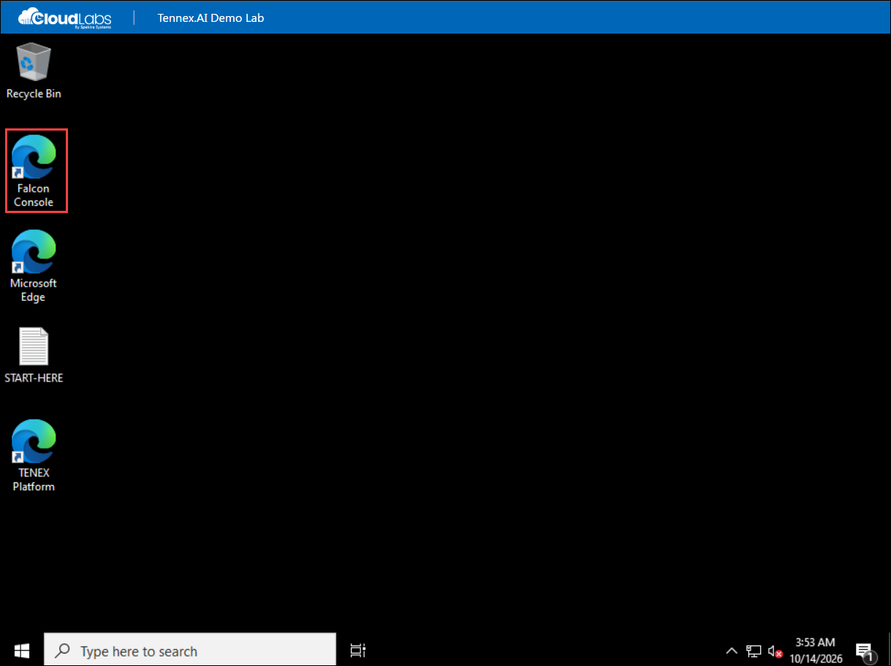
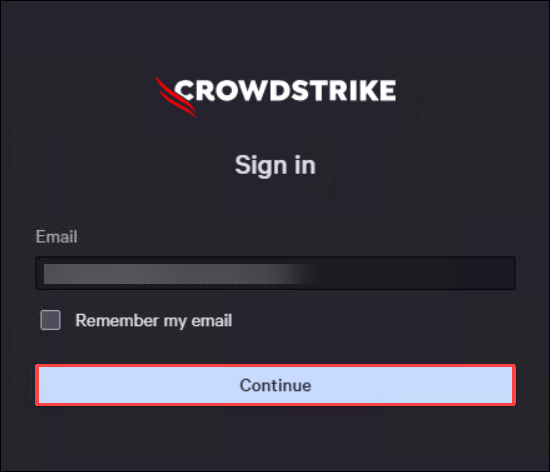
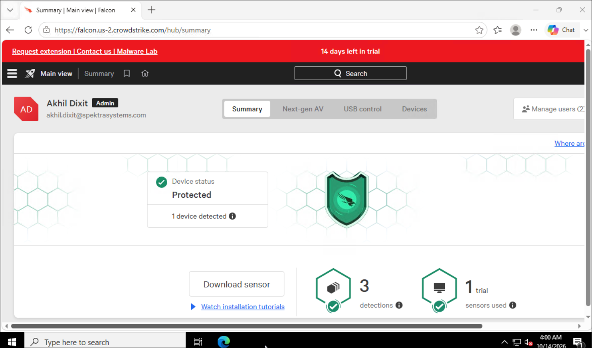
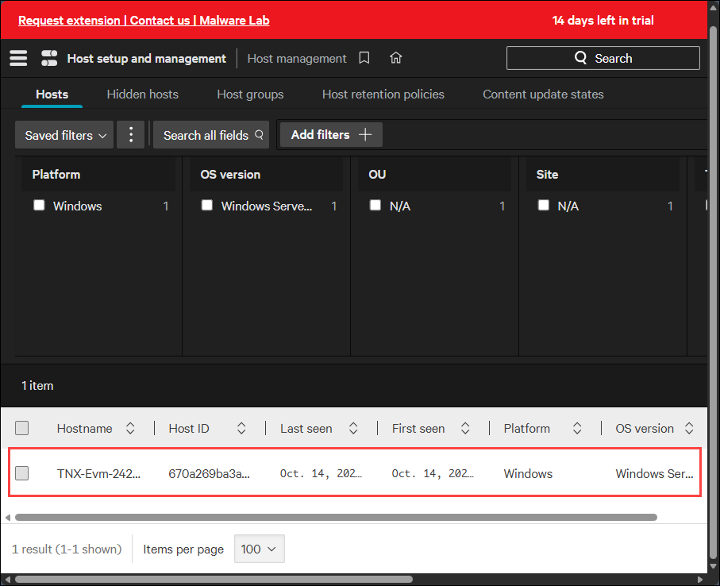

# Detect, Investigate and Contain a Threat with CrowdStrike Falcon and TENEX.AI

## Scenario

You are a security analyst. Somewhere in your estate is a Windows machine that
is about to do something it should not.

In this lab you will play out a compressed version of a real security incident,
following the loop that every security operations team runs on:

**detect → triage → investigate → contain → remediate → close**

You will confirm your endpoint is being monitored, generate real detections at
three different severities, investigate the most serious one, cut the machine
off the network so an attacker cannot spread any further, prove the isolation
actually worked, and then release the machine and close the case.

---

## Your lab environment

Two virtual machines have been provisioned for you.

| | Analyst VM | Endpoint VM |
|---|---|---|
| **Hostname** | <inject key="AnalystHostname" enableCopy="true"/> | <inject key="EndpointHostname" enableCopy="true"/> |
| **Connect to (RDP)** | <inject key="analystRdpAddress" enableCopy="true"/> | <inject key="endpointRdpAddress" enableCopy="true"/> |
| **Public IP** | <inject key="analystPublicIp" enableCopy="true"/> | <inject key="endpointPublicIp" enableCopy="true"/> |
| **Private IP** | 10.0.1.20 | <inject key="endpointPrivateIp" enableCopy="true"/> |
| **Falcon sensor** | No | Yes |
| **Your role here** | This is your desk | This is the machine under attack |

**Sign in to both VMs with:**

| | |
|---|---|
| Username | <inject key="adminUsername" enableCopy="true"/> |
| Password | <inject key="adminPassword" enableCopy="true"/> |

**Falcon and TENEX details:**

| | |
|---|---|
| Falcon console | <inject key="falconConsoleUrl" enableCopy="true"/> |
| Falcon console username | <inject key="falconLoginEmail" enableCopy="true"/> |
| Falcon console password | <inject key="falconLoginPassword" enableCopy="true"/> |
| API client ID | <inject key="falconClientId" enableCopy="true"/> |
| API client secret | <inject key="falconSecret" enableCopy="true"/> |
| API base URL | <inject key="falconApiBaseUrl" enableCopy="true"/> |

### Why there are two machines

This matters, so it is worth understanding before you start rather than being
surprised in Exercise 5.

Network containment cuts the Endpoint VM off from **everything except the
CrowdStrike cloud**. If you were working on the endpoint when you contained it,
your own session to that machine would drop instantly and you would be locked
out mid-exercise.

So you work from the **Analyst VM** throughout. You will visit the Endpoint VM
exactly once, in Exercise 3, to run some commands. Everything else — the Falcon
console, TENEX, the connectivity tests — happens from the Analyst VM.

This also happens to be how real security teams operate. Nobody investigates a
compromised machine by logging into the compromised machine.

---

## Before you begin: connect to the Analyst VM

1. On your own computer, press **Windows + R**, type `mstsc` and press
   **Enter** to open Remote Desktop Connection.

   

2. In the **Computer** field, enter the Analyst VM address:

   <inject key="analystRdpAddress" enableCopy="true"/>

3. Click **Connect**.

4. When prompted for credentials, click **More choices → Use a different
   account**, then enter:

   - **User name:** <inject key="adminUsername" enableCopy="true"/>
   - **Password:** <inject key="adminPassword" enableCopy="true"/>

   

5. Click **OK**. If you see a certificate warning, click **Yes** to continue.

6. The Analyst VM desktop appears. You should see three items placed there for
   you:

   - **START-HERE.txt** — a summary of this environment
   - **Falcon Console** — shortcut to the CrowdStrike console
   - **TENEX Platform** — shortcut to the TENEX platform

   

> **Keep this session open for the whole lab.** It is your workspace. You will
> open a second, separate connection to the Endpoint VM in Exercise 3 and close
> it again straight afterwards.

---

## Exercise 1: Confirm the endpoint is protected

You cannot respond to an incident on a machine you are not monitoring. Before
anything else, confirm the sensor on your endpoint is installed, online and
reporting to the Falcon cloud.

### Task 1: Sign in to the Falcon console

1. On the **Analyst VM**, double-click the **Falcon Console** shortcut on the
   desktop or open **<inject key="falconConsoleUrl" enableCopy="true"/>** URL on the browser.

   

1. Enter the Falcon console username **<inject key="falconLoginEmail" enableCopy="true"/>** and click **Continue**:

   

1. Enter the password **<inject key="falconLoginPassword" enableCopy="true"/>** and click **Continue**:

   

1. The Falcon console opens on the **Main view** dashboard.

   

### Task 2: Find your endpoint

1. In the left navigation menu, click **Host setup and management (1)** and select **Host management (2)**.

   

1. The host list opens, showing every machine reporting into this Falcon tenant.

   > This is a shared lab tenant, so you may see hosts belonging to other participants. Always work with your own hostname, which is shown in your lab details panel.

1. You will see the your endpoint.

   

   >**Note:** In the search all fields box above the host list, your can enter your endpoint hostname and press Enter to search your Host: <inject key="EndpointHostname" enableCopy="true"/>

1. Click the hostname to open the host details.

### Task 3: Verify the sensor is healthy

1. In the host details panel, confirm each of the following:

    | Field | What you should see |
    |---|---|
    | **Host ID** | A unique identifier for this sensor install |
    | **Last seen** | Within the last few minutes |
    | **OS version** | Windows Server 2022 |
    | **Sensor version** | A version number, e.g. 8.10.x |

    

1. Note the **Host ID**. Every machine that installs the sensor generates its
    own, which is how Falcon tells your endpoint apart from everyone else's.

### Expected result

Your endpoint appears in Host management, with a sensor version and a
recent "last seen" timestamp.

> **If the host is not listed or details are not populated**, wait two or three minutes and refresh. The sensor registers shortly after the VM finishes provisioning.

### What just happened

The Falcon sensor is a lightweight agent running in the Windows kernel on the
endpoint. It watches every process start, command line, file write and network
connection, and streams that telemetry continuously to CrowdStrike's cloud.

The host record you just opened is the cloud's view of that machine. Seeing it
online proves the channel is live in both directions — the endpoint can report
to CrowdStrike, and CrowdStrike can send instructions back. That second
direction is what makes Exercise 5 possible.

---

## Exercise 2: Connect the TENEX integration

A real security team does not live in one console. Alerts from CrowdStrike flow
into whatever platform the team actually works in. TENEX connects to Falcon
through its REST API — no agent, nothing installed on your machines.

### Task 1: Collect the API credentials

1. From your lab details panel, copy these three values. You will paste each
   one into TENEX in the next task.

   | Value | |
   |---|---|
   | **API client ID** | <inject key="falconClientId" enableCopy="true"/> |
   | **API client secret** | <inject key="falconSecret" enableCopy="true"/> |
   | **API base URL** | <inject key="falconApiBaseUrl" enableCopy="true"/> |

### Task 2: Add the CrowdStrike connection in TENEX

1. On the **Analyst VM**, double-click the **TENEX Platform** desktop shortcut.

   

1. Sign in with the TENEX credentials provided to you.

1. Navigate to the integrations area and choose to add a new **CrowdStrike
   Falcon** connection.

   

1. Paste in the three values from Task 1 and save the connection.

   

1. Confirm the connection reports as healthy and that TENEX can see your host,
   <inject key="EndpointHostname" enableCopy="true"/>.

   

### Expected result

TENEX shows an active CrowdStrike connection and begins pulling alerts from the
tenant.

> **Note:** depending on how your session is being run, this exercise may be
> demonstrated for you rather than performed by you. If so, read the
> explanation below and move on to Exercise 3 — nothing later in the lab
> depends on having completed this step yourself.

### What just happened

The client ID and secret are a machine identity. TENEX exchanges them for a
short-lived access token and then calls the Falcon API with that token.

The permissions attached to that API client decide what TENEX is allowed to do:

- **Alerts: read** — lets it pull detections, which is the data feed it triages
- **Hosts: read and write** — lets it look up host details and, in Exercise 5,
  contain a machine without anyone opening the Falcon console

This is the integration pattern behind most modern security tooling: one
platform holds the sensors and the data, another consumes it through an API and
acts on it.

---

## Exercise 3: Generate detections

Now you need something to investigate. CrowdStrike provides built-in test
commands that produce genuine detections at chosen severities, without putting
any real malware on the machine.

**This is the only exercise performed on the Endpoint VM.**

### Task 1: Connect to the Endpoint VM

1. Leave your Analyst VM session open. Open a **second** Remote Desktop
   Connection — on your own computer press **Windows + R**, type `mstsc`,
   press **Enter**.

2. Connect to the Endpoint VM:

   <inject key="endpointRdpAddress" enableCopy="true"/>

3. Sign in with the same credentials:

   - **User name:** <inject key="adminUsername" enableCopy="true"/>
   - **Password:** <inject key="adminPassword" enableCopy="true"/>

4. On the desktop you will find **Exercise-3-Test-Commands.txt** containing the
   commands below, in case you prefer to copy them from there.

   

### Task 2: Run the test commands

5. Right-click the **Start** button and select **Terminal (Admin)** — or
   **Command Prompt (Admin)**, depending on the build.

   

6. If a User Account Control prompt appears, click **Yes**.

7. Type the following command and press **Enter**:

   ```
   crowdstrike_test_critical
   ```

8. You will see this response:

   ```
   'crowdstrike_test_critical' is not recognized as an internal or external
   command, operable program or batch file.
   ```

   **This is expected and is not a failure.** Continue to the next command.

   

9. Run the second command and press **Enter**:

   ```
   crowdstrike_test_high
   ```

10. Run the third command and press **Enter**:

    ```
    crowdstrike_test_low
    ```

    

### Task 3 (optional): See prevention in action

11. For a visible on-screen reaction, open **PowerShell** and run:

    ```
    svchost.exe -testisatest
    ```

12. This command behaves differently — Falcon actively blocks it, terminates
    the PowerShell process, and displays a notification on screen.

    

### Task 4: Return to the Analyst VM

13. Close the Remote Desktop session to the Endpoint VM.

14. Switch back to your **Analyst VM** session for the rest of the lab.

### Expected result

Nothing visible happened on the endpoint for the first three commands, but
three new detections now exist in the Falcon console — one Critical, one High
and one Low.

### What just happened

Those three commands are not programs, which is why Windows says it cannot find
them. Nothing executed. But the sensor saw the **command line**, recognised
these reserved strings as CrowdStrike's built-in test triggers, and raised a
detection at the matching severity in the cloud. The entire effect happened
server-side.

The optional PowerShell command is different in kind: that one demonstrates
*prevention* — Falcon terminating a process rather than merely recording it.

**Why three different severities?** Because that is the problem real security
teams actually have. A production Falcon console generates far more alerts than
anyone can read, most of them low priority. Deciding what deserves human
attention is the hard part, and it is exactly what TENEX is built to do. You
have just manufactured, in miniature, the pile of mixed-severity noise an
analyst faces every morning.

---

## Exercise 4: Investigate the critical detection

**Time:** 15 minutes

Three alerts have arrived. An analyst's first job is triage: which one matters,
and what actually happened?

### Task 1: Open the detections list

1. On the **Analyst VM**, in the Falcon console, click **Endpoint security** in
   the left navigation menu.

   

2. Under the **Monitor** section of the flyout, click **Endpoint detections**.

   

3. The detections list opens.

4. Filter the list to your own machine. In the filter bar, filter by **Hostname**
   and enter:

   <inject key="EndpointHostname" enableCopy="true"/>

   

5. Confirm you can see your three detections, with severities **Critical**,
   **High** and **Low**.

   > If only some have appeared, wait a minute and refresh. Detections take a
   > short time to travel from the sensor to the console.

### Task 2: Open the critical detection

6. Click the detection with severity **Critical** to open its details.

   

### Task 3: Walk the evidence

7. **Find the process tree.** This is the visual chain showing what launched
   what. You should be able to read it top to bottom, along these lines:

   ```
   explorer.exe  ->  cmd.exe  ->  crowdstrike_test_critical
   ```

   

8. **Click each process in the tree** and look at the details shown for it.

9. **Find the command line** for the flagged process. This is usually the
   single most valuable field in an investigation — the difference between
   "PowerShell ran" and "PowerShell ran *this*".

   

10. **Find the host details.** Confirm the hostname matches your endpoint, and
    note the user account the process ran under, the OS, and the timestamp.

    

11. **Find the detection metadata** — severity, the tactic and technique it
    maps to, and what action the sensor took.

    

### Task 4: Compare against the others

12. Return to the detections list and briefly open the **High** and then the
    **Low** detection.

13. Notice how similar they look structurally, despite the different
    severities.

### Expected result

You can describe, from the console alone, exactly what ran on the endpoint,
which process launched it, under which user account, and when.

### What just happened

This is the capability that distinguishes EDR — Endpoint Detection and Response
— from traditional antivirus. Antivirus answers one question: "was this file
bad, yes or no?" EDR records the full behavioural history so an analyst can
reconstruct an incident after the fact, including activity that is not
malicious in isolation.

No single step in a modern attack necessarily looks malicious. A document
opens. It spawns a script interpreter. The interpreter reaches out to a
website. The chain is the attack, and the process tree is how you see the chain.

Task 4 is worth dwelling on. Structurally those three alerts look alike, but
only one deserved your time. Multiply that by a few thousand alerts a day and
you have the triage problem that TENEX exists to solve.

---

## Exercise 5: Respond — contain the host

**Time:** 15 minutes

You have decided the Critical detection is real. The priority now is to stop it
spreading, immediately, without waiting to finish the investigation.

**Network containment** blocks all network traffic to and from the endpoint
**except** traffic to the CrowdStrike cloud. The machine is cut off from file
shares, other machines, the internet and any attacker infrastructure — while
you keep full ability to investigate it and to release it later.

### Task 1: Establish your baseline

Before containing anything, prove the network path works. Without a working
baseline, a failed ping later proves nothing.

1. On the **Analyst VM**, click **Start**, type `cmd` and press **Enter** to
   open a Command Prompt.

2. Start a continuous ping to the endpoint's private IP — type `ping -t`
   followed by a space and this address:

   <inject key="endpointPrivateIp" enableCopy="true"/>

3. Confirm you are getting **Reply from** lines.

   

4. **Leave this window running and visible.** You are going to watch it change
   in real time.

### Task 2: Contain the host

5. In the Falcon console, go to **Host setup and management → Host management**.

6. Find and select your endpoint:

   <inject key="EndpointHostname" enableCopy="true"/>

7. Open the host actions dropdown at the top of the host details — it is
   labelled **Host group assignment** with a chevron next to it.

8. Click **Network contain host**.

   

9. A confirmation dialog appears: *"Are you sure want to network contain this
   host?"* It explains that containing this host will only allow communication
   with CrowdStrike and will stop communication with your network and the
   internet.

10. Optionally type a note in the **Audit log entry** box, for example
    `Lab exercise - containing after critical detection`.

11. Click **Contain**.

    

### Task 3: Verify containment took effect

Two independent checks:

12. **Watch your ping window.** Within about a minute, the `Reply from` lines
    change to `Request timed out`.

    

13. **Check the console.** The host status for your endpoint now reads
    **Contained**.

    

> If you still had a Remote Desktop session open to the Endpoint VM, it has now
> dropped. That is containment working as designed, not a lab failure.

### Task 4: Lift containment

14. In the Falcon console, select your endpoint again.

15. Open the same host actions dropdown and click **Lift network containment**.

    

16. Confirm the action.

17. Watch the ping window again. Within about a minute, `Reply from` lines
    return.

    

18. Press **Ctrl + C** in the Command Prompt to stop the continuous ping.

### Expected result

You contained a host, proved by two independent means that it was isolated,
then released it and proved connectivity recovered.

### What just happened

Containment is enforced by the sensor itself, in the kernel on the endpoint —
not by a network device, a firewall rule or a switch port. That is why it works
identically whether the machine is in a datacentre, in Azure, or on an
employee's home wifi.

The deliberate exception for CrowdStrike cloud traffic is the clever part. The
machine is isolated from everything that could do harm, but **not** from you.
You keep investigating it, you keep issuing commands to it, and you release it
when you are ready. A quarantine you could not reverse remotely would not be
much use.

In a real incident this single action is what buys the team time: ransomware
stops spreading laterally, data stops leaving, and the attacker loses their
channel — in seconds, from a browser, without anybody walking to a desk.

---

## Exercise 6: Close the case and reset

**Time:** 5 minutes

An incident is not finished when the threat is stopped. It is finished when the
record is closed and the environment is back to a known state.

### Steps

1. In the Falcon console, go to **Endpoint security → Monitor → Endpoint
   detections**.

2. Filter by **Hostname** using your endpoint:

   <inject key="EndpointHostname" enableCopy="true"/>

3. Select all three of your detections using the checkboxes on the left.

   

4. Set the status to **Closed**.

   

5. Add a brief comment, for example:

   ```
   Lab test detection - verified benign, no action required.
   ```

6. Confirm the host is no longer showing as Contained in Host management.

7. End your lab session.

### Expected result

No open detections remain for your host, and the host is in a normal,
uncontained state.

### What just happened

Closing alerts is not administrative tidiness. An alert left open is an alert
someone else will re-investigate, and a console full of stale alerts is how
genuine incidents get missed. Status and disposition are what let a team
measure itself: how many alerts were real, how fast they were handled, what the
false positive rate looks like.

When you relaunch this lab you will get a brand new endpoint with a brand new
identity in the Falcon console, and none of today's detections. Every session
starts clean.

---

## Troubleshooting

| Symptom | What to check |
|---|---|
| Endpoint not listed in Host management | Wait 2–3 minutes after provisioning and refresh. The sensor registers shortly after first boot. |
| Test commands produce no detections | Confirm you opened Command Prompt **as Administrator**, and that you are on the Endpoint VM, not the Analyst VM. Allow a minute for the detection to reach the console. |
| Many hosts listed, cannot find mine | This is a shared tenant. Filter by your exact hostname from the lab details panel. |
| Ping fails before you contain anything | Confirm you are pinging the **private** IP from the **Analyst VM**, not the public address. |
| Ping still succeeds after containment | Give it up to 60 seconds; the instruction has to reach the sensor. Then confirm the console shows the host as *Contained*. |
| "Network contain host" is not in the menu | Your console account may not hold a role that permits containment. Raise it with your lab instructor. |
| RDP to the endpoint stopped working | Expected if the host is contained. Lift containment and it returns. |
| Falcon console asks for MFA setup | Follow the on-screen prompts using the authenticator app indicated by your instructor. |

---

## What you covered

| Concept | Where you saw it |
|---|---|
| Endpoint telemetry and sensor registration | Exercise 1 |
| API-based security integration | Exercise 2 |
| Detection severity and alert volume | Exercise 3 |
| Process trees and behavioural investigation | Exercise 4 |
| Network containment as a response action | Exercise 5 |
| Case closure and environment hygiene | Exercise 6 |

The loop you just completed — **detect, triage, investigate, contain,
remediate, close** — is the core rhythm of security operations. The hard part
in a real environment is not any single step; it is doing it across thousands
of alerts a day without missing the one that mattered. That is the problem
TENEX.AI is built to solve, and Exercise 3's three severities were your first
look at it.
